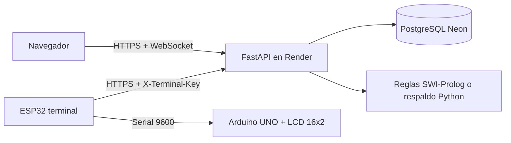

# Bitácora del proyecto LavaRESI

Sistema de turnos para la lavadora y la secadora de una residencia estudiantil. 
Los estudiantes reservan turno desde una página web o desde una terminal física (ESP32 + Arduino UNO), y todo se sincroniza en un servidor en la nube.


## Resumen

| Parte | Tecnología |
|---|---|
| Backend / API | Python + FastAPI (uvicorn) |
| Base de datos | PostgreSQL en Neon |
| Reglas de turnos | SWI-Prolog (con respaldo en Python si no está instalado) |
| Frontend | HTML + CSS + JavaScript puro, servido por el mismo FastAPI |
| Tiempo real | WebSocket (`/ws/estado`) con consulta periódica de respaldo |
| Terminal física | ESP32 (joystick, control remoto IR, 2 LED RGB, buzzer) |
| Pantalla | Arduino UNO + LCD I2C 16x2, recibe texto del ESP32 por serial |
| Nube | Render (backend + frontend), Neon (base de datos) |

## Arquitectura



**Idea central:** el backend es la única fuente de verdad. Ni la web ni el ESP32 deciden turnos: solo piden y muestran. El cronómetro de cada ciclo vive en el servidor, y el ESP32 y la web solo lo descuentan visualmente entre consultas.

## Bitácora por fecha

### 2026-10-06 · Definición y arquitectura
- Se definió el problema: evitar que los estudiantes pierdan el turno de la lavadora y la secadora.
- Se eligió FastAPI + PostgreSQL (Neon) y una terminal física con ESP32 + Arduino UNO.
- Se acordó que cada máquina tiene su propia cola y que una persona puede pedir de 1 a 3 tandas.

### 2026-10-09 · Base de datos y esqueleto del backend
- Esquema de tablas: usuarios, máquinas, solicitudes, ciclos y notificaciones.
- Conexión a Neon mediante la variable de entorno `DATABASE_URL`.
- Script de inicialización que crea las tablas y las dos máquinas (1 = lavadora, 2 = secadora).

### 2026-10-14 · Cuentas, sesiones y turnos
- Registro e inicio de sesión: contraseña para la web y PIN de 4 dígitos para la terminal.
- Contraseñas y PIN guardados con hash PBKDF2 (nunca en texto plano).
- Sesión por cookie. Límite de intentos de PIN incorrectos por IP.
- Rutas de turnos: pedir, cancelar, marcar ausente/disponible, avisos.

### 2026-10-19 · Reglas de turnos en SWI-Prolog
- Se escribió `reglas_turnos.pl` para decidir quién sigue en la cola (salta a quien está ausente sin perder su antigüedad).
- El backend llama a Prolog y, si `swipl` no está instalado, usa un respaldo en Python con la misma lógica.

### 2026-10-23 · Frontend web inicial
- Páginas: iniciar sesión / crear cuenta, vista pública de disponibilidad, panel del estudiante (mis turnos, pedir turno, avisos).
- Visitantes ven solo cuántas personas esperan. Con sesión se ven nombres y la cola completa.
- Cronómetro que cuenta localmente cada segundo, sin consultar al servidor.

### 2026-10-28 · Rutas de terminal y firmware
- Rutas para la terminal protegidas con la cabecera `X-Terminal-Key`.
- Sketch del ESP32: menú por joystick y control IR, PIN, elegir tandas, ingresar minutos, retirar la ropa.
- Sketch del Arduino UNO: recibe `linea1|linea2` por serial y la muestra en la LCD, con caracteres especiales (`¿`, `á`).
- LED RGB por máquina: verde = libre, rojo = en uso, amarillo = pendiente de retiro. Buzzer: 2 pitidos al iniciar y al retirar, 3 al terminar.

### 2026-11-03 · Pruebas locales de integración
- El backend corre en el computador y el ESP32 se conecta por Wi-Fi a la IP local.
- Se confirmó el flujo completo: crear cuenta en la web → pedir turno en la terminal → iniciar ciclo → terminar → retirar.

### 2026-11-07 · Problemas al arrancar
- El servidor no arrancaba por falta de `DATABASE_URL`: el archivo `LavaRESI.env` no estaba en la carpeta del backend.
- La página no recibía actualizaciones al instante: faltaba la biblioteca de WebSocket (`uvicorn[standard]`).

### 2026-11-10 · Optimización del rendimiento del backend
- **Síntoma:** iniciar sesión, crear cuenta y pedir o cancelar turnos tardaban muchísimo y la página parecía congelada.
- **Causas encontradas:**
  1. Cada petición abría una conexión nueva a Neon.
  2. Un candado global afectaba incluso a las consultas de solo lectura.
  3. El vigilante de ciclos tomaba ese candado cada 1.5 s.
- **Cambios:**
  - `db.py`: pool de conexiones (`psycopg_pool`) y función `lectura()` sin candado.
  - `main.py`: el vigilante hace una consulta de lectura y solo escribe cuando un ciclo realmente venció.
  - `publico.py`, `web.py`, `terminal.py`: `/api/estado`, `/api/yo` y `/mi-turno` usan `lectura()`.
  - `requirements.txt`: se agregó `psycopg[binary,pool]`.
- **Resultado:** las respuestas pasaron de varios segundos a casi inmediatas (sin medición formal).

### 2026-11-11 · Rediseño completo del frontend
- Nuevo diseño: barra superior oscura y tarjetas con una "ventana de lavadora" circular que cambia de color según el estado (verde, rojo girando, amarillo).
- Barra de carga animada arriba y círculo girando dentro de los botones mientras esperan al servidor.
- Si el WebSocket no conecta, la página consulta cada 3 s (antes 15 s).

### 2026-11-12 · Ajustes de la interfaz
- Se corrigió el espacio entre la ventana circular y la lista de espera.
- "Marcar como leídos" ahora oculta los avisos al instante en la pantalla y avisa al servidor por detrás. Los avisos viejos no se borran de la base.
- Versionado de archivos estáticos (`?v=6`) para evitar la caché del navegador.

### 2026-11-13 · Despliegue en Render
- Se subió el backend con el frontend a Render y se configuraron las variables de entorno `DATABASE_URL`, `LAVARESI_SECRET` y `LAVARESI_TERMINAL_KEY`.
- Comando de arranque con soporte para proxy:
  `uvicorn app.main:app --host 0.0.0.0 --port $PORT --proxy-headers --forwarded-allow-ips="*"`
- En Render no hay SWI-Prolog, así que se usa el respaldo en Python (misma lógica).

### 2026-11-14 · ESP32 conectado a la nube
- Render solo acepta HTTPS, así que el firmware pasó de `HTTP` a `HTTPS` con `WiFiClientSecure`.
- Cambios en el sketch: nueva dirección `API_BASE`, un cliente seguro para el estado (conexión reutilizada) y otro para las operaciones, tiempos de espera más largos, pila de tareas ampliada y consulta de estado cada 2 s.
- El sketch del Arduino UNO no necesitó cambios.

## Rutas que usa la terminal (ESP32)

| Método y ruta | Para qué |
|---|---|
| `GET /api/estado` | Estado de ambas máquinas y las colas (cada 2 s) |
| `POST /api/terminal/mi-turno` | Ver turnos de una persona con su PIN |
| `POST /api/terminal/solicitudes` | Pedir turno |
| `POST /api/terminal/ciclos/iniciar` | Iniciar el ciclo (1 a 180 minutos) |
| `POST /api/terminal/ciclos/retirar` | Confirmar que se retiró la ropa |
| `GET /api/health` | Comprobar que el servidor responde |

Todas llevan la cabecera `X-Terminal-Key` (debe ser igual a `LAVARESI_TERMINAL_KEY` del servidor).

## Estructura del repositorio

```
software/
├── backend/
│   ├── app/
│   │   ├── main.py            # arranque, vigilante de ciclos
│   │   ├── db.py              # pool de conexiones a Neon
│   │   ├── config.py, seguridad.py
│   │   ├── rutas/             # publico, terminal, web, eventos (WebSocket)
│   │   ├── servicios/         # turnos, prolog
│   │   └── modelos/           # esquemas de datos
│   ├── prolog/reglas_turnos.pl
│   └── requirements.txt
└── frontend/
    ├── index.html
    ├── css/estilos.css
    └── js/app.js
```

Los sketches del ESP32 (`LavaRESI_ESP32_Render.ino`) y del Arduino UNO se guardan aparte.

## Cómo ejecutarlo en local

```powershell
cd software\backend
python -m pip install -r requirements.txt
$env:Path += ";C:\Program Files\swipl\bin"
# cargar DATABASE_URL, LAVARESI_SECRET y LAVARESI_TERMINAL_KEY desde LavaRESI.env
python -m uvicorn app.main:app --host 0.0.0.0 --port 8000
```

Abrir `http://localhost:8000/`. Para que el ESP32 use el servidor local, abrir el puerto 8000 en el firewall de Windows.

## Problemas encontrados y soluciones

| Problema | Causa | Solución |
|---|---|---|
| `Falta la variable de entorno DATABASE_URL` | No existía `LavaRESI.env` en `backend/` | Colocar el archivo y cargar las variables antes de `uvicorn` |
| `No supported WebSocket library` y `404` en `/ws/estado` | Faltaba la biblioteca de WebSocket | `pip install "uvicorn[standard]"` |
| Página lenta y botones congelados | Conexión nueva a Neon por petición y candado global | Pool de conexiones, `lectura()` sin candado y vigilante liviano |
| Parecía congelado sin aviso | No había indicador de carga | Barra de carga superior y círculo en los botones |
| El círculo tapaba la lista de espera | Posición absoluta sin espacio reservado | Más margen bajo la lista de espera |
| Avisos tardaban en desaparecer | Se esperaba al servidor antes de actualizar | Ocultar al instante en pantalla y avisar por detrás |
| ESP32 no podía hablar con Render | Render solo acepta HTTPS | `WiFiClientSecure` y nueva `API_BASE` |

## Seguridad

- Contraseñas y PIN con hash PBKDF2. Límite de intentos de PIN incorrectos por IP.
- La terminal usa la clave `X-Terminal-Key`. Sin ella, `/api/estado` devuelve solo un resumen público.
- **No subir a Git:** `LavaRESI.env`, `.secreto`, `lavaresi.db` ni las claves y la contraseña del Wi-Fi del sketch. Sugerido en `.gitignore`:

```
LavaRESI.env
.secreto
*.db
__pycache__/
```

- Si alguna clave se compartió por error, cambiarla en Render y en el sketch.

## Limitaciones y mejoras pendientes

- El plan gratis de Render se duerme tras 15 minutos sin visitas; la primera petición puede tardar hasta un minuto.
- El ESP32 usa `setInsecure()`: cifra la conexión pero no valida el certificado del servidor. Mejora futura: cargar el certificado raíz.
- En local, cada acción abre un proceso `swipl`; si sigue lento, usar un proceso Prolog persistente.
- Algunas consultas hacen varias idas y vueltas a Neon (`/api/yo`); se pueden combinar.
- Opción para borrar avisos de la base y no solo ocultarlos.