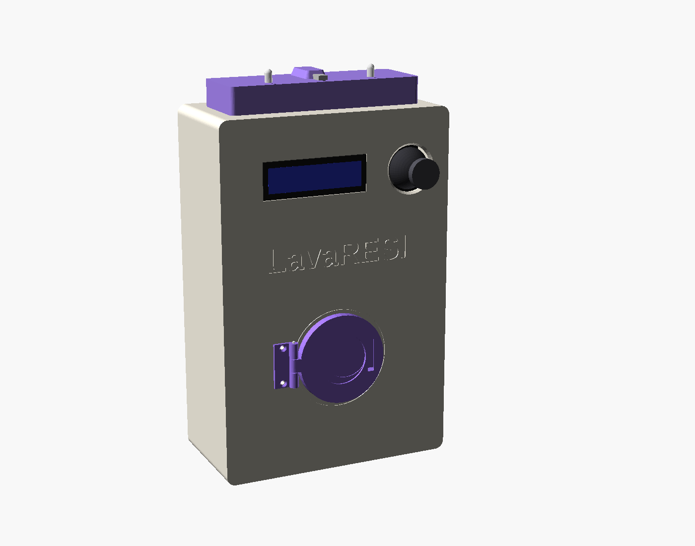
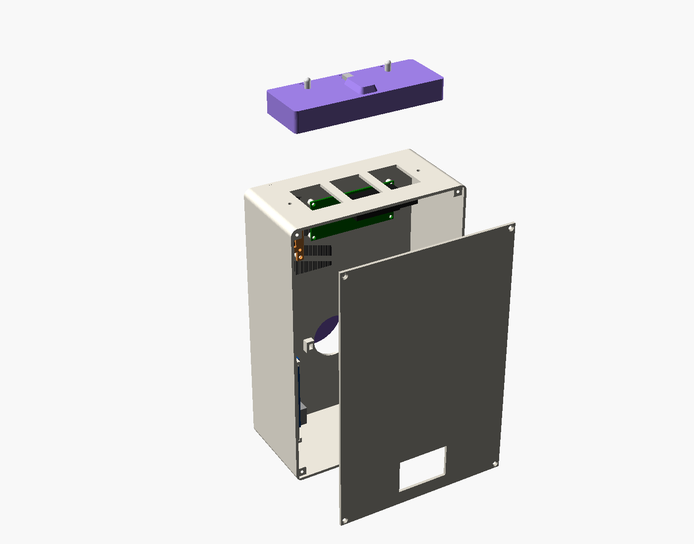
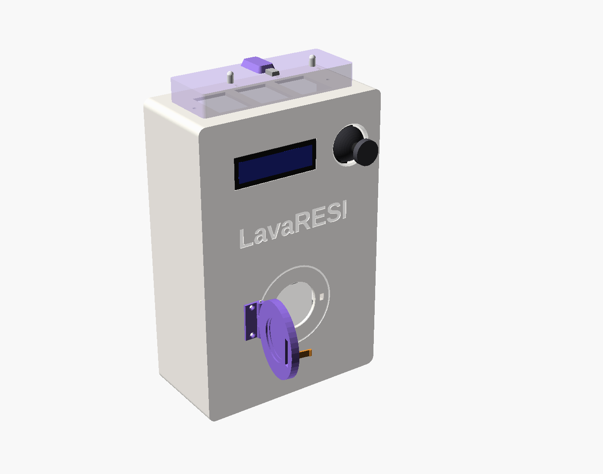
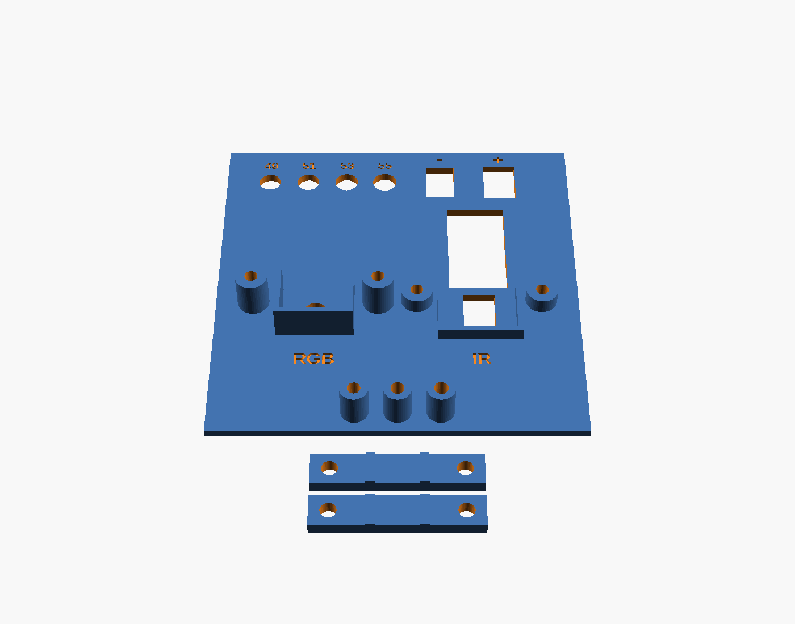

# Modelo 3D — Carcasa de LavaRESI

Carcasa con forma de lavadora para el prototipo LavaRESI. Aloja el ESP32, el Arduino UNO, la pantalla LCD 16x2, el joystick, dos LEDs RGB, el receptor infrarrojo y dos protoboards.



| | |
|---|---|
| **Medidas generales** | 160 × 240 × 80 mm (+ 18 mm de la sección superior) |
| **Herramienta de diseño** | [OpenSCAD](https://openscad.org) 2021.01 o superior (modelo paramétrico) |
| **Impresora usada** | Bambu Lab X1 Carbon |
| **Material** | PLA, ≈ 530 g en total |

## Contenido

```
modelo-3d/
├── lavaresi.scad        # Modelo editable (todas las medidas son variables)
├── stl/                 # Piezas finales, ya orientadas para imprimir
│   └── plantillas/      # Piezas de prueba de calce
└── imagenes/            # Capturas del modelo
```

## Piezas

| Archivo | Cant. | Descripción | Orientación de impresión |
|---|---|---|---|
| `cuerpo.stl` | 1 | Caja principal con ventanas del LCD, joystick y puerta | Frente sobre la cama (necesita cama ≥ 245 × 165 mm) |
| `tapa_trasera.stl` | 1 | Cierre trasero con guía para 2 protoboards y salida de cables | Plana |
| `modulo_superior.stl` | 1 | Sección elevada con 2 LEDs RGB y el receptor IR | Techo sobre la cama |
| `pancita_ir.stl` | 1 | Tapa hueca sobre el conector del IR | Parte plana sobre la cama |
| `puerta.stl` | 1 | Puerta con agarradera hundida | Cara trasera sobre la cama |
| `bisagra.stl` | 1 | Hoja fija de la bisagra | De pie, tal como viene |
| `pestillo.stl` | trae 2 | Gancho de cierre tipo microondas (uno de repuesto) | Acostado, tal como viene |
| `pasador.stl` | trae 2 | Pasador de la bisagra (opcional; mejor filamento de 1.75 mm × 32 mm) | Acostado |
| `bandeja_uno.stl` | 1 | Bandeja deslizable del Arduino UNO | Plana, postes hacia arriba |
| `soporte_joystick.stl` | 1 | Soporte trasero del joystick | Plano |
| `puente.stl` | trae 3 | Sujetadores de las plaquitas RGB/IR | Planos |

**Configuración de impresión:** PLA · capa 0.20 mm · 3 paredes · 20 % de relleno · **sin soportes** · no girar las piezas.

**Tiempo estimado en la X1 Carbon:** unas 10 – 13 h en 3 tandas: cuerpo (6 – 8 h), tapa trasera (2 – 2.5 h) y piezas pequeñas (≈ 1 h 48 min).



## Distribución interna

- **Frente:** LCD 16x2 (a ras del panel), joystick (el domo sale por un agujero de 31 mm) y puerta.
- **Sección superior:** LED RGB 1, receptor IR y LED RGB 2, sujetos por puentes atornillados.
- **Tapa trasera:** 2 protoboards de 830 puntos unidos (100 × 165 mm), con el ESP32 sobre la unión.
- **Pared derecha:** Arduino UNO en una bandeja que entra por rieles desde atrás, con el USB hacia abajo.
- **Puerta:** abre con bisagra y, por una ventana de 40 mm, deja ver el interior. Cierra con un pestillo de gancho, sin imanes.



## Tornillería (30 tornillos M3)

Agujero guía de **2.8 mm** (calibrado con las plantillas).

| Cant. | Medida | Cabeza | Uso |
|---|---|---|---|
| 14 | M3 × 6 | Redonda | LCD (4), puentes RGB/IR (6), Arduino UNO (4) |
| 4 | M3 × 6 | Baja (o redonda) | Placa del joystick a su soporte |
| 4 | M3 × 8 | Redonda | Soporte del joystick a sus columnas |
| 2 | M3 × 8 | Avellanada | Bisagra |
| 2 | M3 × 10 | Redonda | Sección superior |
| 4 | M3 × 10 | Avellanada | Tapa trasera |

Además: 1 pasador de filamento de 1.75 mm × 32 mm.

## Plantillas de calce

Piezas pequeñas (10 – 20 min cada una) para probar los componentes reales antes de imprimir la carcasa:

| Archivo | Qué prueba |
|---|---|
| `plantillas/plantilla_lcd.stl` | Ventana y postes del LCD |
| `plantillas/plantilla_joystick.stl` | Agujero del domo, columnas y soporte del joystick |
| `plantillas/plantilla_superior.stl` | Celdas RGB e IR, agujeros de prueba del LED (4.9 – 5.5 mm), ventanas del IR y postes de tornillo (2.8 / 2.9 / 3.0 mm) |



## Cómo modificar el diseño

1. Abre `lavaresi.scad` en OpenSCAD.
2. Cambia las medidas en la sección **"MEDIDAS DE LOS COMPONENTES"** o desde *Window → Customizer*. Los decimales van con **punto** (`2.5`, no `2,5`).
3. Elige la pieza con la variable `PARTE` (por ejemplo `PARTE = "puerta";`).
4. **F5** para la vista previa, **F6** para renderizar y luego *Archivo → Exportar → STL*.

| Valor clave | Variable | Valor actual |
|---|---|---|
| Agujero guía para M3 | `pilot_d` | 2.8 mm |
| Holgura de ventanas | `tol` | 0.3 mm por lado |
| Ventana del receptor IR | `ir_win` | 7.0 × 10.0 mm |
| Bloque de protoboards | `proto_blk` | 100 × 165 mm |
| Domo del joystick | `jx_dome_d` | 28 mm |

## Autor

Andy Alvarado — diseño, modelado e impresión de la carcasa. Ver [bitácora](../bitacoras/Andy/bitacora.md).
